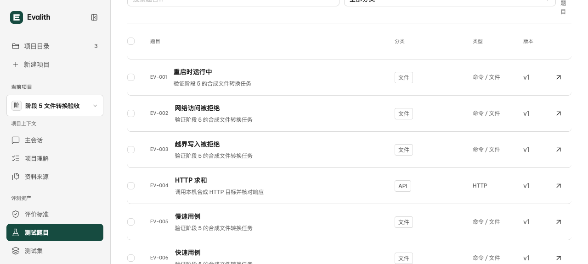
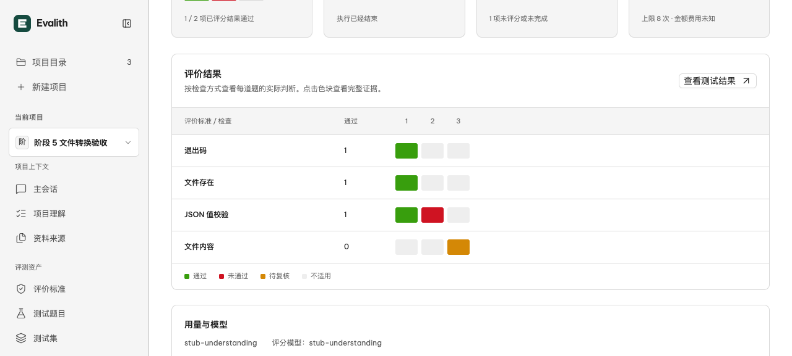

# Evalith

[](https://github.com/frostloom/Evalith/actions/workflows/evalith-tests.yml)

**本地优先的 Agent 评测工作台。** 从项目资料和业务需求出发，生成可追溯的测试资产，在隔离环境中运行真实 Agent，并用证据而不是一次性的对话记录判断结果。



## 为什么需要 Evalith

Agent 的行为通常依赖业务规则、工具调用、项目上下文和外部状态。只保存一段提示词或一个模型分数，无法说明它为什么通过，也无法在代码变化后重复验证。

Evalith 把评测拆成可以维护、复用和审计的资产：

- **项目理解有来源**：区分资料支持的事实、模型推断和尚未确认的规则。
- **题目和评分都可以版本化**：题目、Rubric、Grader、模型和阈值不会因后续编辑而改写历史运行。
- **运行前先确认评分计划**：逐题展示实际采用的 Grader、模型、阈值和不适用原因。
- **执行结果按证据保存**：工具轨迹、stdout、文件、退出码、检查、耗时、用量和清理状态都可查看。
- **失败不会被伪装成低分**：执行错误、缺失证据、待复核、预算停止、取消、中断和清理失败具有不同状态。

## 核心能力

| 模块 | 能力 |
| --- | --- |
| 项目 | 本地目录导入、只读资料范围、持续会话、来源理解、敏感文件排除 |
| 测试资产 | 自动生成或手工创建题目、Rubric、Grader、测试集，支持修订版本与归档 |
| 评分 | 确定性检查、模型判分、按已知结果校准 Grader、逐题评分预检与冻结快照 |
| 执行 | 本地命令、loopback HTTP、Harbor 容器和项目专用 Go 适配器 |
| 多轮对话 | 脚本轮次，以及由模拟器模型驱动的自适应后续轮次 |
| 运行管理 | 调用与金额预算、取消、超时、服务重启恢复、逐题持久化、历史记录 |
| 结果 | 状态矩阵、对话与评分证据、独立结果分析、事实/推断分离、费用未知语义 |

## 工作方式

1. 导入本地项目，选择允许分析的资料范围和模型。
2. 在项目主会话中核对理解、补充业务规则，明确可以继续。
3. 生成或编辑题目、Rubric、Grader 和测试集。
4. 确认隔离环境，运行评分预检，选择题目并设置预算。
5. 执行 Agent，实时保存逐题结果和证据。
6. 查看失败原因，选择范围生成独立分析报告。



## 快速开始

### 环境要求

- Python 3.12+
- Node.js 22+
- [uv](https://docs.astral.sh/uv/)
- macOS 本地命令执行还需要系统 `sandbox-exec`

### 启动

```bash
git clone https://github.com/frostloom/Evalith.git
cd Evalith
./scripts/start-local.sh
```

打开 [http://127.0.0.1:8093](http://127.0.0.1:8093)。

脚本会在 Evalith 内安装 Python 依赖、安装前端依赖、构建页面并启动服务。运行数据、缓存和证据默认保存在 `.evalith/`。

常用配置：

```bash
EVALITH_API_PORT=8093
EVALITH_DATA_DIR=/absolute/path/to/evalith-data
EVALITH_ALLOW_PAID_MODELS=1
EVALITH_HARBOR_BIN=/absolute/path/to/harbor
```

这些变量可以写入被 Git 忽略的 `.evalith/local.env`。

## 模型接入

Evalith 使用标准 OpenAI 兼容接口。一个模型配置包含：

- 服务地址，例如 `https://provider.example/v1`
- 模型名称
- 可选的 API Key

API Key 加密保存，只用于请求头，不返回浏览器，也不传给被测 Agent。

同一模型网关用于理解、讨论、资产生成、评分和结果分析，也可以为被测 Agent、Grader、模拟器和分析任务分别选择模型。付费模型默认关闭；设置 `EVALITH_ALLOW_PAID_MODELS=1` 后才能保存和使用。

金额无法从接口可靠计算时，Evalith 将其显示为“未知”，不会显示为零。运行调用上限在每次模型请求前检查。

## 执行器

| 执行器 | 适用任务 | 隔离方式 |
| --- | --- | --- |
| 本地命令 / 文件 | 命令行、脚本和产物检查 | macOS `sandbox-exec`，每题独立目录 |
| HTTP API | loopback 服务调用 | 专用测试地址与显式确认 |
| Harbor | 命令任务 | Docker 容器、无网络、产物回收 |
| Go Agent 适配器 | 对话与工具调用 | 独立 SQLite、内存 Redis 和项目适配进程 |

本地命令执行目前只支持 macOS。HTTP 执行器只接受 loopback 地址。Harbor 需要 Harbor CLI、Docker 和本地镜像缓存。

## 数据与安全

- 项目资料以只读方式扫描，并记录文件哈希和来源。
- 绝对路径、目录越界、符号链接逃逸和敏感文件名会被拒绝。
- 密钥不会进入题目、普通日志或被测环境。
- 每次运行冻结题目版本、评分计划、模型、执行器和预算。
- 历史运行不会被后续题目或 Grader 编辑覆盖。
- 数据库、证据和环境副本默认保留在 `.evalith/app/`，不会自动删除。
- 服务重启后，未完成项目会标记为中断；清理状态无法确认时显示未知，清理调用失败时显示失败。

## 开发

后端测试：

```bash
UV_CACHE_DIR="$PWD/.evalith/cache/uv" uv run --project evalith \
  pytest -c evalith/pyproject.toml evalith/tests \
  --basetemp .evalith/tmp/pytest
```

前端测试与构建：

```bash
npm --prefix evalith/web test
npm --prefix evalith/web run build
```

静态检查：

```bash
cd evalith
uv run ruff check src/evalith ../scripts/stage5_acceptance.py
```

完整验收：

```bash
uv run --project evalith python scripts/stage5_acceptance.py \
  --base-url http://127.0.0.1:8093 \
  --out .evalith/stage5/acceptance \
  --repo "$PWD" \
  --phase all
```

## 当前状态

- 阶段 5 的确定性端到端验收已合并到 `main`。
- 后端 **300** 项、前端 **58** 项测试通过，生产构建和静态检查通过。
- 确定性验收覆盖命令/文件、HTTP、预算、取消、重启恢复、版本快照、隔离边界和清理失败。
- 真实模型生成、判分、校准和对话闭环需要由使用方提供受控的 OpenAI 兼容端点。
- Harbor 当前支持命令任务；Compose 多服务、云沙箱和 Harbor 内 LLM Agent 不在当前范围。
- 当前版本面向可信本地单用户环境，不提供多租户、云托管或生产系统无隔离接入。

## 文档

- [运行与功能说明](evalith/README.md)
- [阶段 5 验收报告](docs/stage5/2026-11-20-阶段5-MVP验收.md)
- [项目访问与安全边界](docs/stage1/project-access.md)
- [自动资产准备与评分编排验证](docs/validation/2026-11-13-functional-review.md)
- [真实项目执行验证](docs/validation/2026-11-12-real-evaluation.md)
