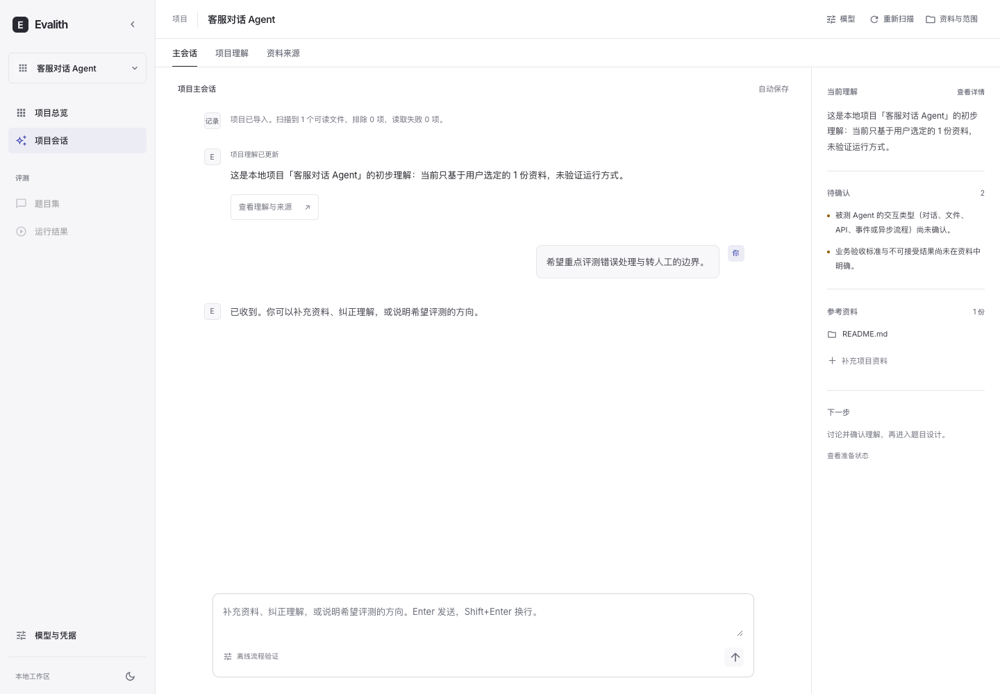
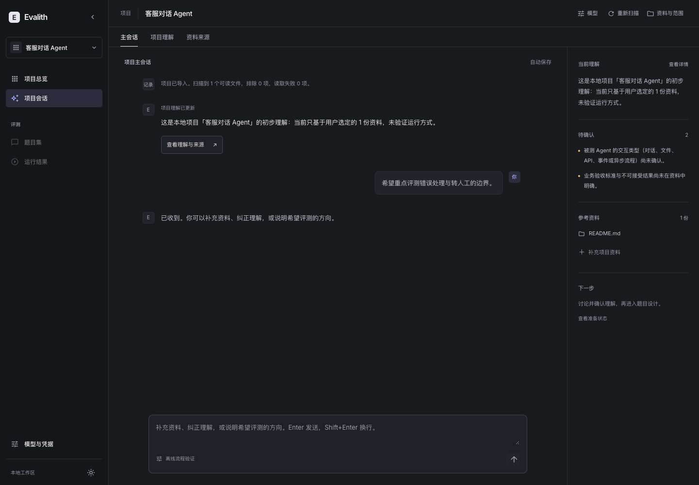
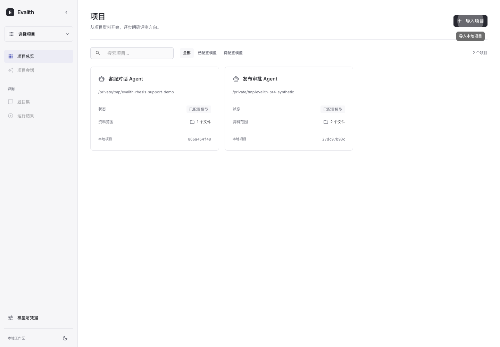
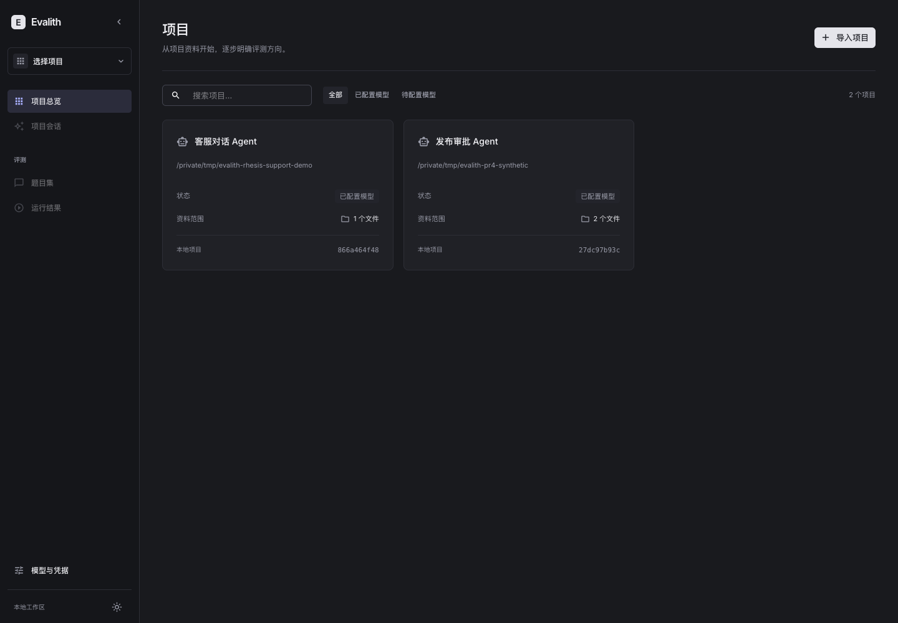
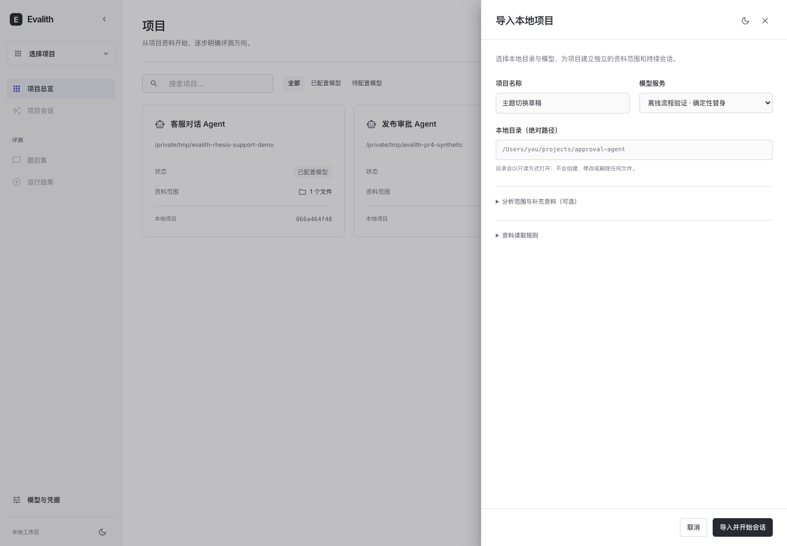
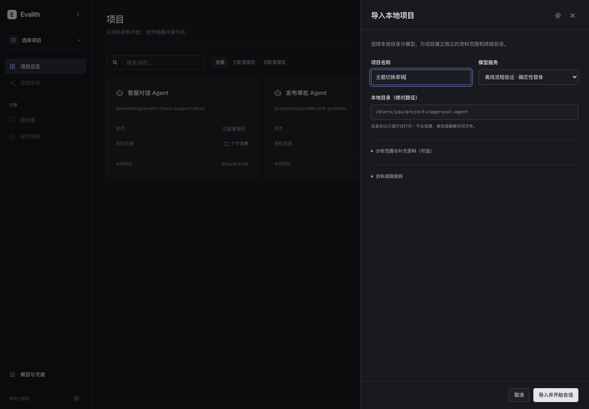

# Linear 深浅主题与 PRD 验证

2026-11-11。按用户确认的 Linear 深色、浅色方向重做桌面工作区，使用 `frontend-design` skill，交互以 `docs/PRD.md` 的阶段 1 流程为准。取代此前的前端视觉方案。

## 页面与交互

- 中性黑白灰、细边框、紧凑字体与留白，Inter 字体本地加载；克制使用靛蓝选中态。深浅主题共用语义色板，侧栏与抽屉均可切换，刷新保留选择。
- 首页保留项目卡片、搜索与模型配置筛选。导入抽屉优先展示名称、模型和本地目录，资料范围与补充文档按需展开。
- 进入或导入项目后直接显示项目主会话。右栏集中展示理解摘要、主要未知项、来源和下一步；完整理解及资料来源通过三个页签切换。
- 模型配置、项目模型和资料编辑使用统一右侧抽屉；删除模型先确认。表单错误显示在操作处，支持 Escape、焦点恢复和键盘操作。
- 切换主题或同项目页签保留草稿。项目切换继续隔离会话、来源与待完成请求；浏览器前进、后退和刷新恢复项目页签。

## PRD 对照与范围

| PRD 要求 | 当前行为 |
| --- | --- |
| 首页项目卡片、配置模型、导入项目 | 保留真实 API，导入后立即进入会话 |
| 每项目一条持续主会话 | 沿用后端唯一主会话及历史记录 |
| 精简初步理解、来源、未知项 | 会话内摘要与上下文栏；详情区分已知、推断、未知 |
| 用户纠正或补充资料 | 会话输入与资料抽屉均可完成 |
| 足够依据或明确继续前不推进 | 沿用 readiness；资料变化显示历史理解并要求重新核对 |
| 后续题目设计、运行及结果 | 阶段 2+ 尚未实现；导航禁用，不显示虚构结果 |

本次未修改后端。保留访问边界、凭据保护、快照指纹、过期理解提示和异步响应隔离。

## 验证

- `uv run --directory evalith pytest -q`：完整后端回归通过，退出码 0；仅有现有 Starlette/httpx 弃用警告。
- `npm --prefix evalith/web test`：3 个文件、31 项通过。新增回归覆盖默认进入主会话、深浅切换和持久化、切换主题保留会话与导入草稿；保留项目隔离、迟到响应、取消导入、中文输入法、来源编辑、过期理解及路由测试。
- `npm --prefix evalith/web run build`：TypeScript 与 Vite 生产构建通过。React 与 MUI 分包，无循环分块警告。
- 真实浏览器检查项目目录、会话、资料和模型抽屉的两套主题；验证导入、主题切换、取消、错误提示及键盘关闭。实际完成合成项目导入、发送并刷新恢复会话；修改合成资料后重新扫描，确认主会话右栏显示历史理解、重新核对提示，详情页禁止继续。主要截图为 1440×1000，移动端仅保留基础适配。
- axe WCAG 2 A/AA：深浅会话页各 27 项通过，均为 0 violations、0 incomplete。抽屉检查也无违规；焦点遮罩和部分动态背景产生的 incomplete 项按键盘焦点、对比色和截图人工检查，不能据此声称完整无障碍认证。
- 截图和浏览器流程使用临时合成项目及确定性离线模型，无真实业务数据、密钥或付费模型调用；未验证真实模型判断质量。

## 实际页面

| 浅色 | 深色 |
| --- | --- |
|  |  |
|  |  |
|  |  |

[资料过期提示](evidence/evalith-linear-dark-stale.png)、[深色资料编辑](evidence/evalith-linear-dark-sources-drawer.png)、[浅色资料编辑](evidence/evalith-linear-light-sources-drawer.png)、[模型表单错误](evidence/evalith-linear-dark-model-validation.png)。

Linear 仅作视觉参考，未复制其专有素材或源码。Rhesis 的 MIT 复用声明见 `evalith/web/NOTICE.md` 与 `RHESIS-LICENSE`；Inter 的 OFL 随字体提交。
