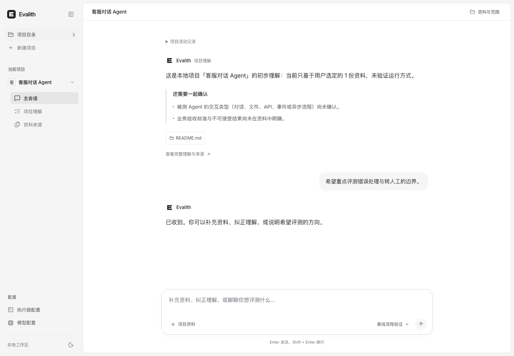
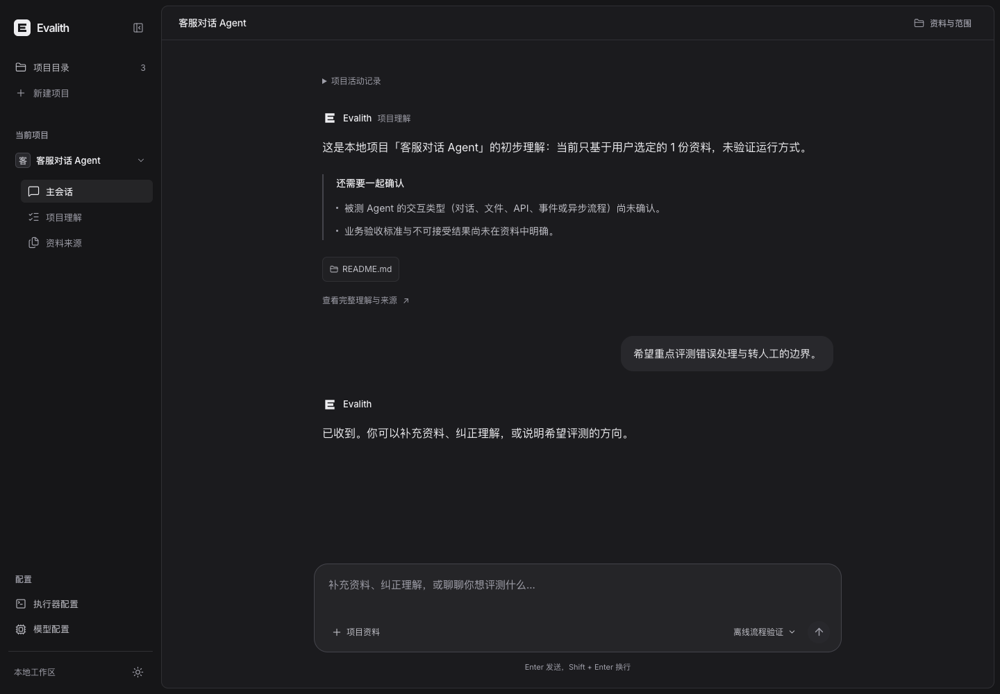
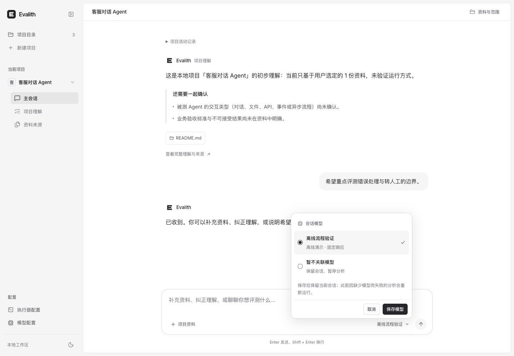
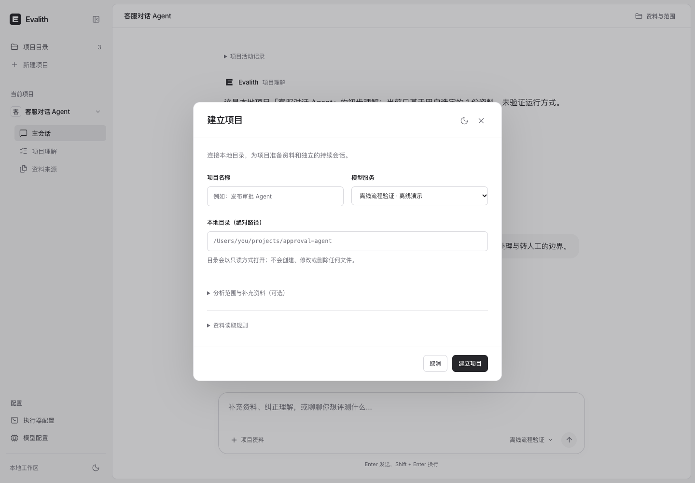
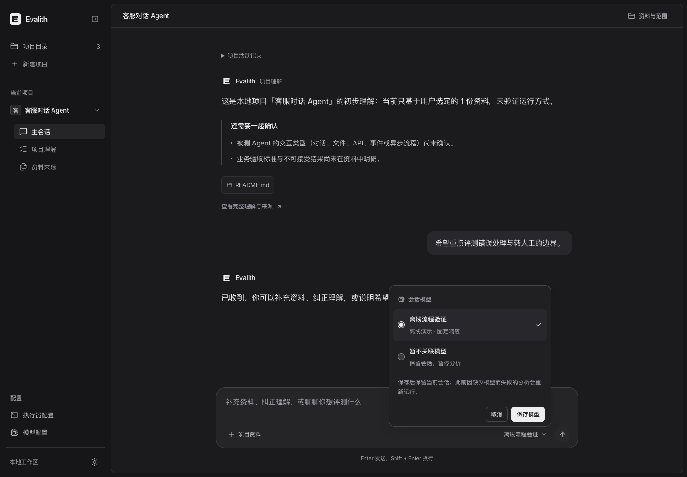
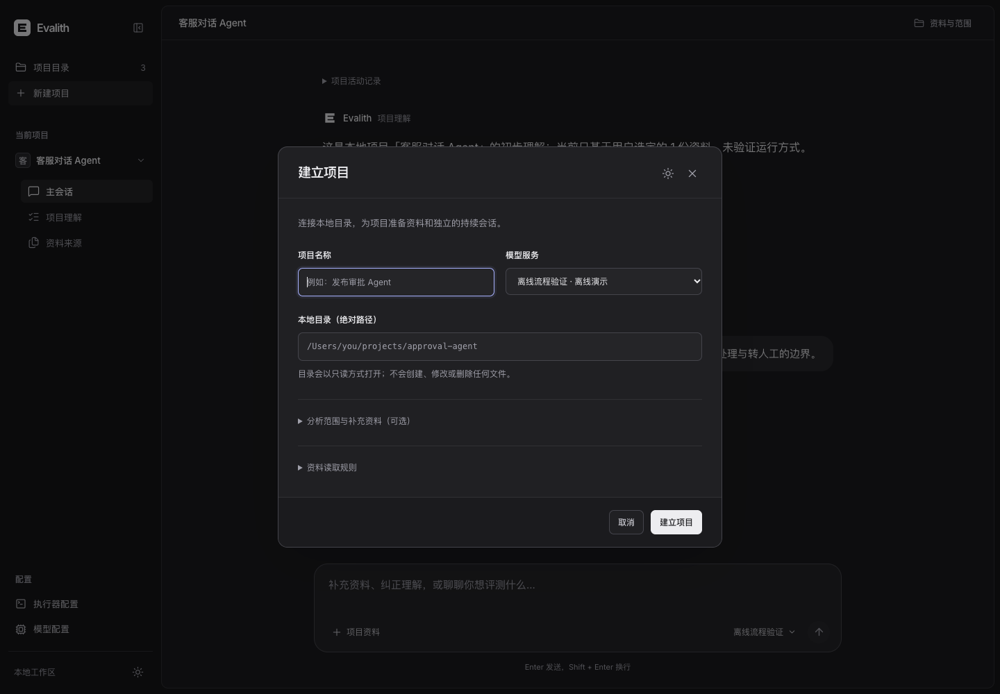
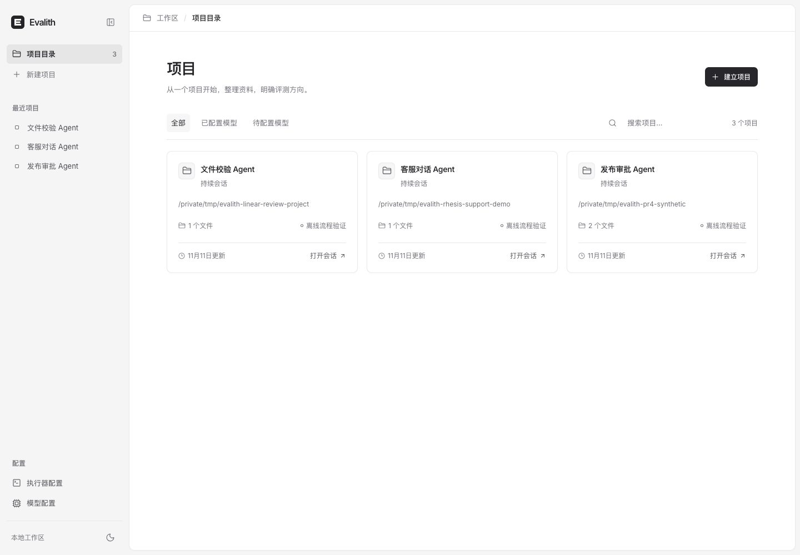
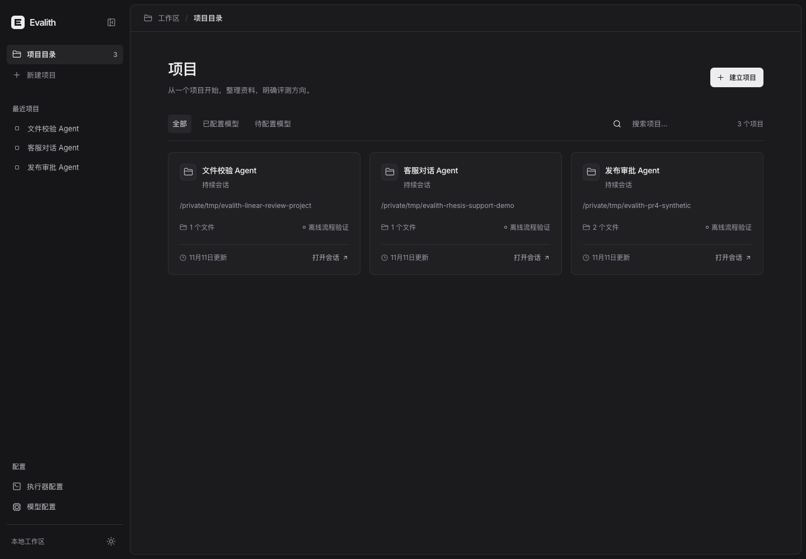

# 产品导航、会话与对话框

2026-11-11。用户再次否定上一轮整体观感，要求直接参考成熟产品的导航、会话、对话框和交互。此轮使用 `design-taste-frontend`，实际打开 [Linear 工作区演示](https://linear.app/demo) 和 [assistant-ui 的 Claude 演示](https://www.assistant-ui.com/demos/claude)，操作侧栏及模型菜单。参考的是结构与交互惯例，未复制品牌资产、代码或专有截图。

## 界面和交互

- 中性深浅色，紧凑侧栏。项目目录和新建入口在上方；最近项目或当前项目章节居中；模型、执行器在底部独立配置组。修复折叠侧栏的文字隐藏规则。
- 项目目录保持先建立卡片、再点击进入会话的流程。卡片减少嵌套色块，目录路径、资料数和模型引用均为真实 API 数据。
- 会话采用开放正文、灰色用户气泡与紧凑的理解提示，移除整块理解外框。正文、输入区按同一阅读宽度对齐。
- 模型选择就地向上展开，选中后明确保存；取消或 Escape 不应用选择，关闭后恢复触发按钮焦点。
- 输入框随内容增长至 200px，之后内部滚动。发送期间显示回复状态、阻止重复 Enter；阅读历史时保留位置，可点击回到最新消息。中文输入法与 Shift+Enter 行为保持。
- 建立项目、添加模型及执行器表单采用居中对话框；会话资料编辑保留上下文侧栏。对话框有标题关联、焦点管理和键盘关闭。

## 验证与限制

43 项前端测试及 TypeScript/Vite 构建通过。新增回归覆盖模型菜单显式保存、取消与 Escape、草稿保留、发送状态和重复 Enter、历史阅读位置及回到最新消息。实际浏览器检查深浅主题、菜单、居中表单、折叠导航和长文本输入。桌面优先，移动端仅保留基础布局。

深色会话 axe WCAG2A/AA 检查为 0 自动违规、0 待人工确认项；模型菜单为 0 自动违规，存在弹层焦点与重叠背景需人工确认项。已检查可见布局及键盘关闭/恢复焦点，未声称完整无障碍认证。

**设计 skill 检查器：GATE: ERROR。** 其独立检查脚本未找到 Chrome（提示设置 CHROME_PATH），因此 consistency、layout 和 copy 检查未运行，不计为通过。已按 skill 的错误处理说明记录，不重复运行。页面与交互检查使用可用的 agent-browser 浏览器。此项目是实际应用，营销首屏、随机视觉素材和宣传页分屏规则不适用。

本轮没有后端修改，执行器仍只保存定义。所有页面是临时合成项目和离线模型，没有真实业务资料或付费调用。视觉结果仍需用户反馈，不以测试或 CI 代替视觉验收。frostloom2 保持暂停。

## 实际截图

| 浅色会话 | 深色会话 |
| --- | --- |
|  |  |

| 模型菜单 | 建立项目 |
| --- | --- |
|  |  |
|  |  |

| 浅色项目目录 | 深色项目目录 |
| --- | --- |
|  |  |

[执行器配置](evidence/evalith-product-executors-light.png)、[模型配置](evidence/evalith-product-models-light.png)。
