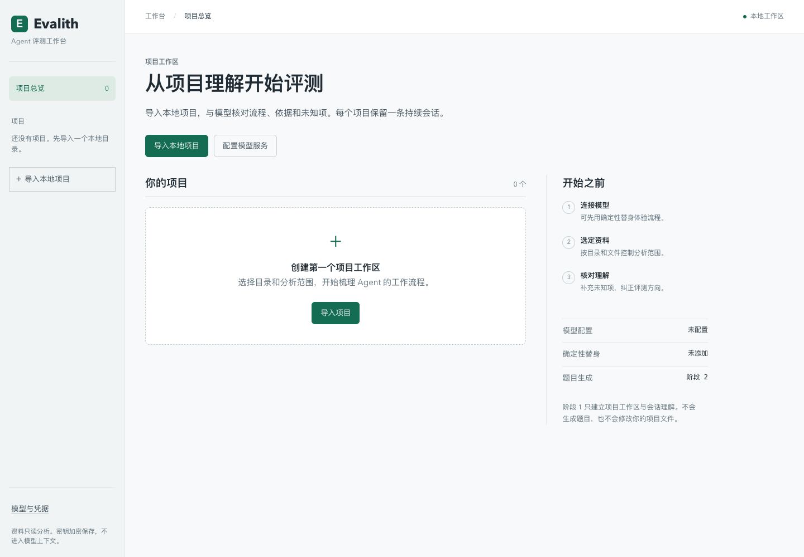
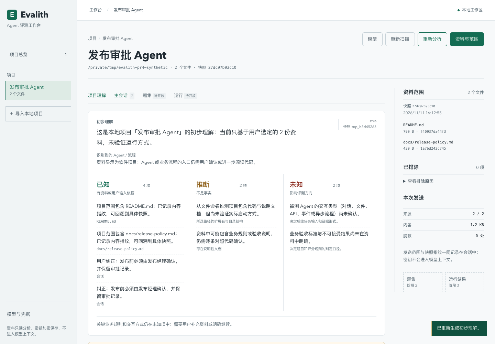
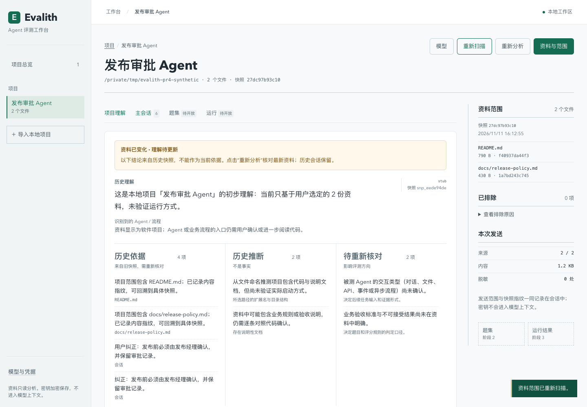

# PR #4 接管修复与界面验证

日期：2026-11-11（北京时间）。对应 [Issue #3](https://github.com/frostloom/Evalith/issues/3) / [PR #4](https://github.com/frostloom/Evalith/pull/4)。本次基于 `b157e61e8e8987e08666ade40df7dc5bb1a2b2be`，由 Codex 直接实现和验证。

## 问题与修复

最新评审的具体缺陷是资料变化后，旧摘要和事实仍以当前“已知”呈现。此前 CI 已成功；CI 成功不能替代这一行为的验证。

- 服务按分析快照与当前快照的内容摘要计算 `understanding.stale`。修改或删除文件会标记理解过期；只增加一个被排除的凭据文件等扫描诊断变化，不会误判内容过期。
- 历史摘要、来源与会话保留。界面明确提示“资料已变化”，将“已知”改为“历史依据”，推断与未知项也标记为历史或待核对。
- 过期状态关闭推进门并隐藏继续按钮。继续接口先重新扫描：即使用户没有刷新页面，也不能批准过期理解，返回 409 `understanding_stale`；前端随后读取最新状态。
- 成功重新分析后恢复当前依据。用户已在会话中作出的纠正继续保留，不因快照变更丢失。

## 界面

沿用 React 19 / TypeScript / Vite。浅灰底、白色内容面、绿色主操作；系统无衬线字体用于中文阅读，等宽字体只用于路径和指纹。

- 项目总览提供明确的空状态、项目入口、模型状态和开始步骤。
- 项目导航、讨论主区、资料与发送范围各有固定位置；资料较多时仍能核对来源。
- 项目理解和主会话可直接跳转；题集与运行保持“待开放”状态。
- 手机导航可展开，选择目的地后收起；操作按钮和证据内容按窄屏重新排列。
- 补充键盘跳转入口、当前导航标记、可见焦点；修正辅助文字对比度。快照时间使用浏览器本地时间。







[手机工作区截图](evidence/evalith-pr4-mobile.png)

## 验证

使用 `/tmp` 下的合成发布审批项目、独立的临时数据目录和确定性替身模型；没有调用付费模型，也没有写入被分析的原项目。

| 检查 | 结果 |
| --- | --- |
| 后端单元/集成测试 | 218 项通过（239.70 秒）；1 项现有 Starlette/httpx 弃用警告 |
| 前端测试 | 21 项通过 |
| TypeScript + Vite 生产构建 | 通过 |
| EE-free 工作台 smoke | `passed: true`，用户消息与 worker assistant 回复均存在，errors 为空 |
| 浏览器实际流程 | 模型保存、项目导入、发送纠正、重开恢复、修改资料、过期提示、重新分析通过 |
| 布局宽度 | 1440、1024、768、390、320；未发现横向溢出 |
| axe WCAG 2 A/AA | 正常工作区、过期理解、手机工作区、手机导入页均为 0 项违规；在页面动画结束后检查 |
| Git diff whitespace | 通过 |

新增回归覆盖文件修改、文件删除、未刷新时继续、诊断变化不误判、过期理解的历史标记、发现过期后的界面同步，以及手机导航展开/收起。

工作台 smoke 原始证据：[workbench-smoke-1794384318.json](evidence/workbench-smoke-1794384318.json)。此次复用了已生成并运行的固定源码工作台，没有重新生成 EE-free 树；smoke 校验现有产物、锁文件摘要及消息/worker 路径。

可从仓库根目录复跑：

```bash
uv run --directory evalith pytest -q
npm --prefix evalith/web test
npm --prefix evalith/web run build
# 工作台依赖与进程需先按 workbench/README.md 启动
uv run --directory evalith python ../workbench/smoke.py
```

确定性替身通过不代表真实模型理解、工具调用或评测质量。容器项目挂载、多用户认证、题集/运行闭环仍属于后续阶段。本次没有把“未逐行审完全部 diff”当作一个可修复的代码缺陷，也没有据此声称整个大 PR 不存在其他问题。
