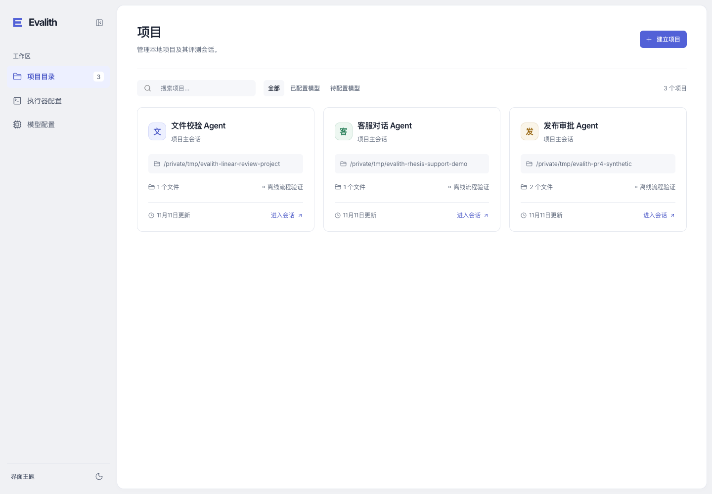
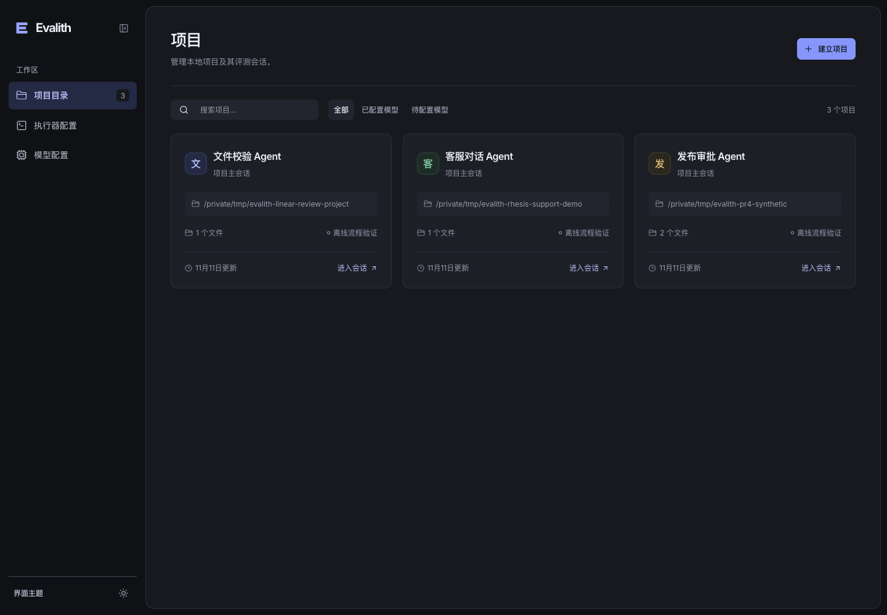
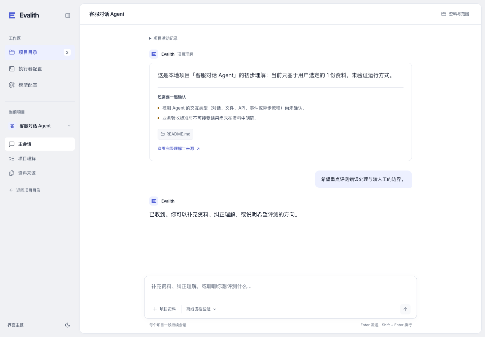
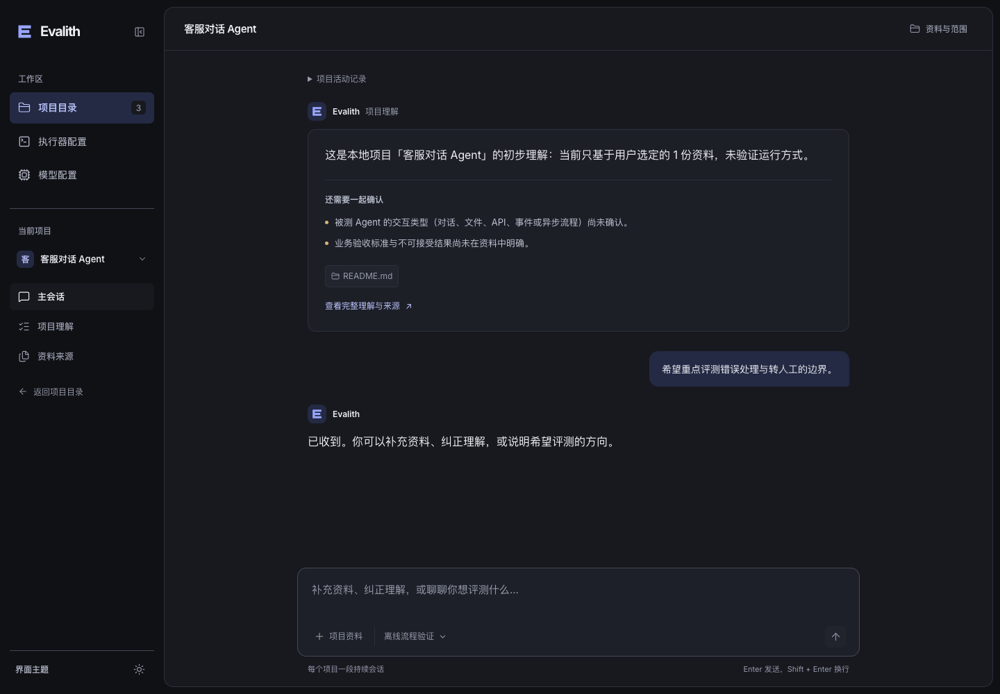
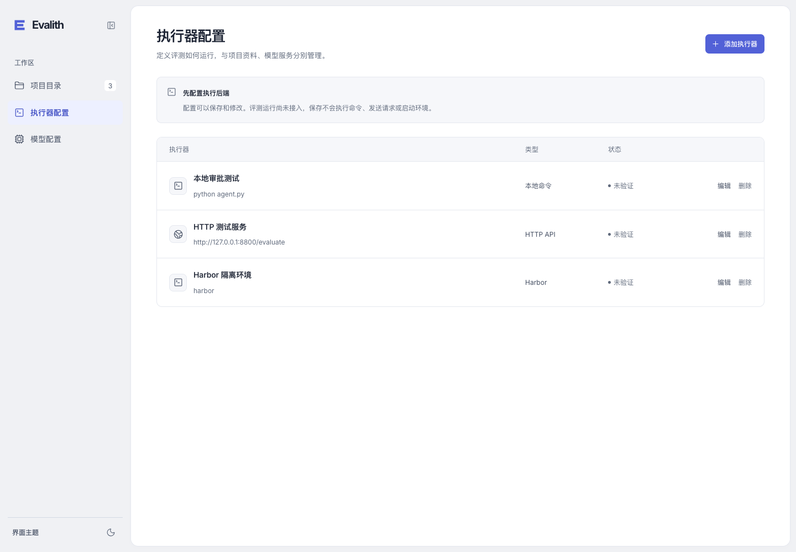
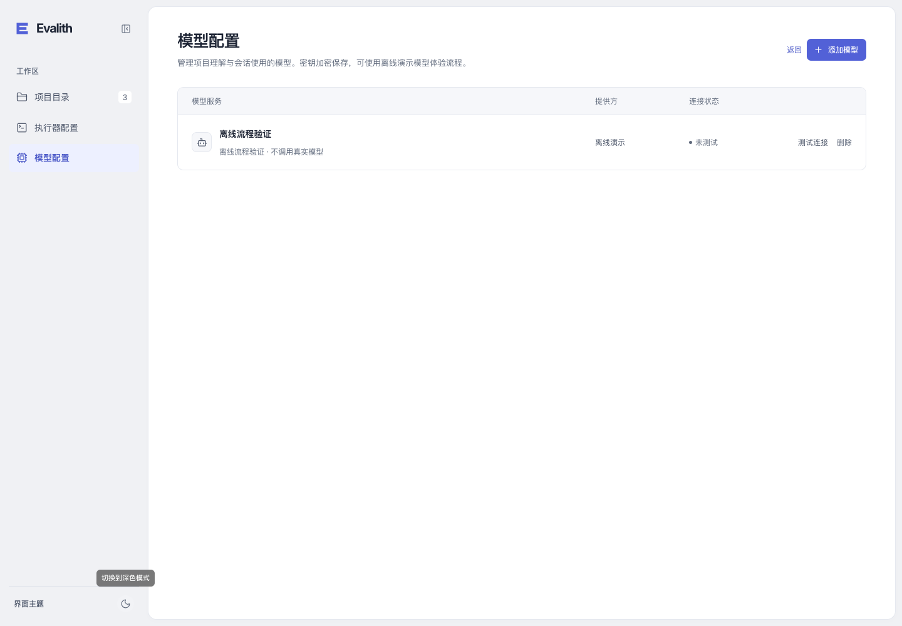
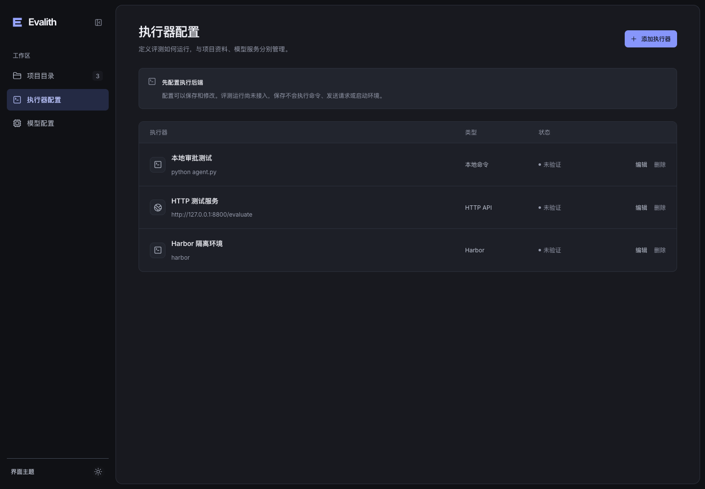
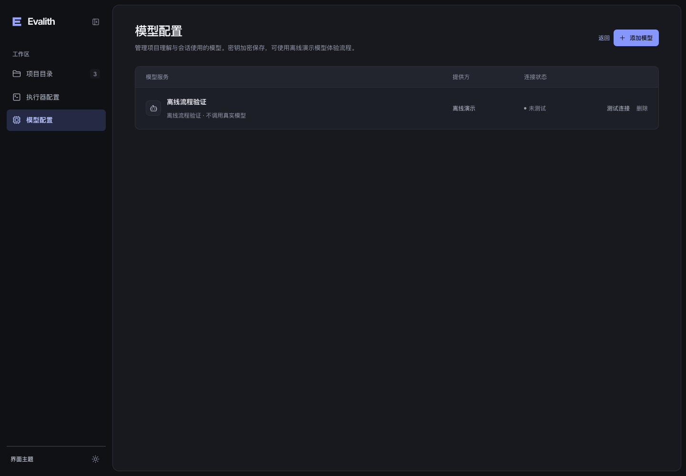

# 界面整体重做：桌面视觉方案

2026-11-11。用户明确上一版整体、会话、字体及布局均未达到要求。本轮使用 `frontend-design` skill，重新打开并操作 [Linear 官方演示工作区](https://linear.app/demo) 的项目和事项页面，重建前端视觉系统。功能验证与用户的视觉验收分开记录；测试通过不代表用户接受设计。

## 本轮变化

- 用 236px 工作区侧栏和内嵌内容画布重新组织整体比例。项目目录、执行器配置、模型配置保持独立入口；进入项目后才显示项目会话、理解和来源导航。
- 新的色板、边框、圆角与字号体系。正文 16px，工作区导航 14px，辅助信息以 12px 为主；深浅主题覆盖同一组组件。
- 使用统一 Lucide 线条图标和原创 Evalith 标记，移除前端对 Material Icons 包的依赖；ISC 许可随静态资源提供。
- 项目卡片按名称、目录、实际资料数量、已关联模型和进入会话入口组织，不展示虚构进度或结果。
- 初步理解、普通模型回复、用户消息、来源引用和输入区重新分层；保留完整理解入口、未知项、过期资料提示与继续门。
- 模型与执行器配置列表、建立项目与资料表单采用同一套对齐和控件规格，错误出现时保持会话输入区可见。
- 离线模型的界面文案改为“离线演示”，仍明确它是固定响应，不代表真实模型能力。

## 功能范围与验证

创建项目后先显示卡片，点击卡片进入主会话；三个独立入口、API、数据结构、来源边界及异步响应保护保持不变。执行器依然只保存定义，项目绑定、连接验证和实际运行未接入。后续阶段功能不可用，导航只展示当前可用章节。

本轮未修改后端。现有 39 项前端回归及 TypeScript/Vite 构建通过。真实浏览器检查了深浅项目目录、会话、两种配置页、建立项目表单及 Escape 关闭。会话、配置页的 axe WCAG2A/AA 无自动检测违规；目录搜索框存在需要人工确认的对比度项，已核对实际输入色、占位色及背景。未声称完整无障碍认证。移动端仅保留基础布局。

所有页面使用临时合成项目及离线模型，没有真实业务数据、真实凭据或付费模型调用。未复制 Linear 的源码、文案或专有素材。

## 实际页面

| 浅色项目目录 | 深色项目目录 |
| --- | --- |
|  |  |

| 浅色会话 | 深色会话 |
| --- | --- |
|  |  |

| 执行器配置 | 模型配置 |
| --- | --- |
|  |  |
|  |  |

[空目录](evidence/evalith-reset-empty-light.png)、[建立项目](evidence/evalith-reset-create-light.png)。之前的截图保留为历史方案。视觉方案等待用户反馈，PR 不据功能检查结果自动合并。
