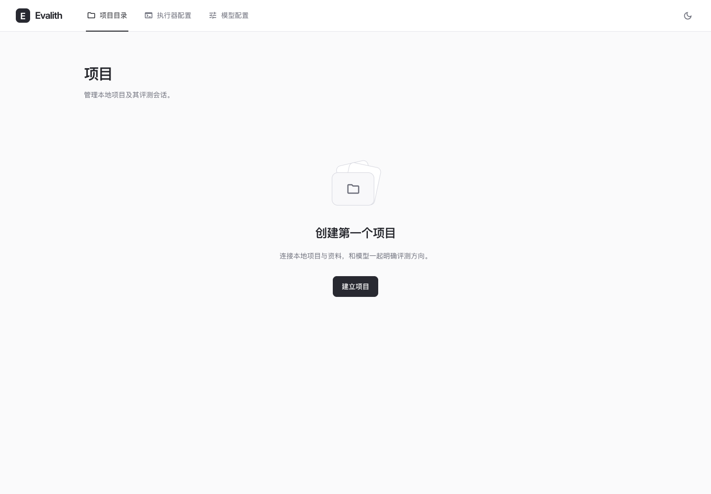
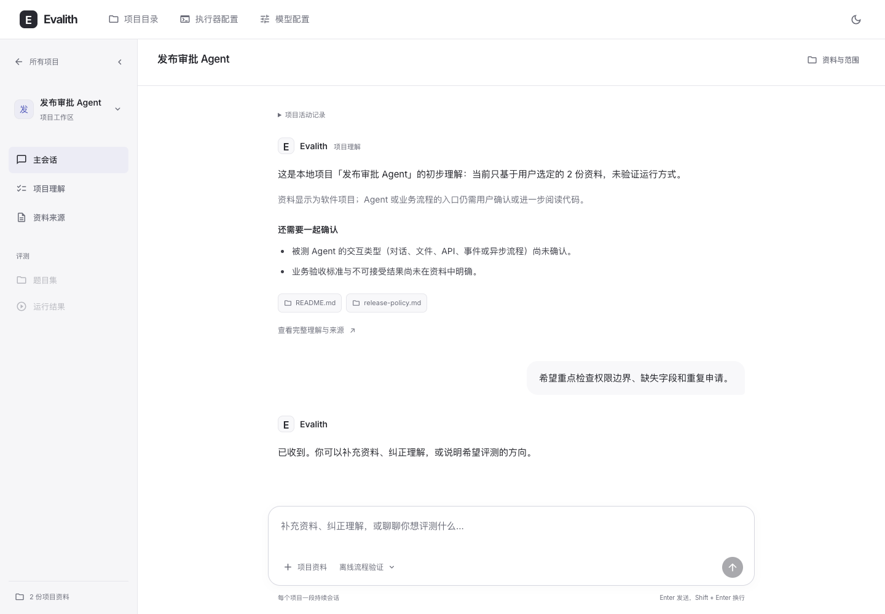
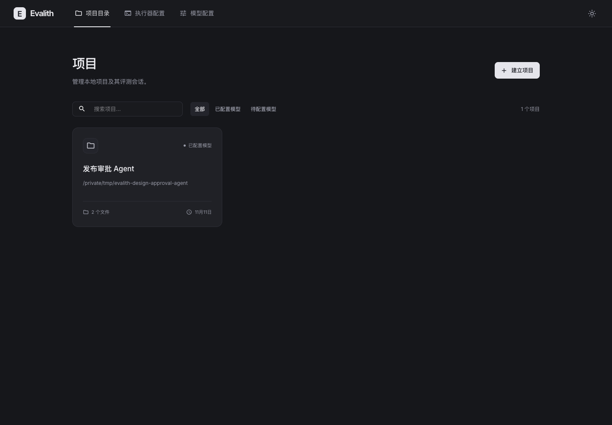
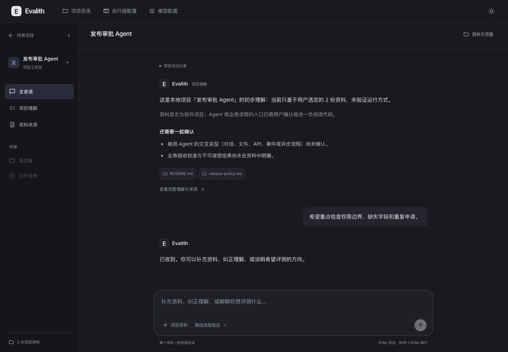
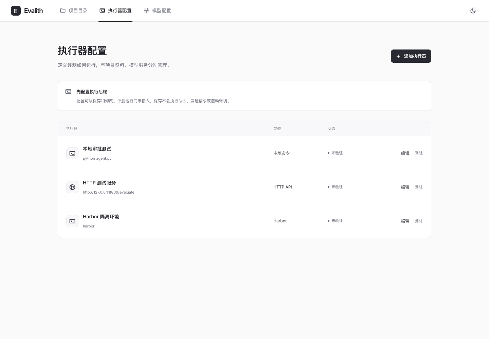
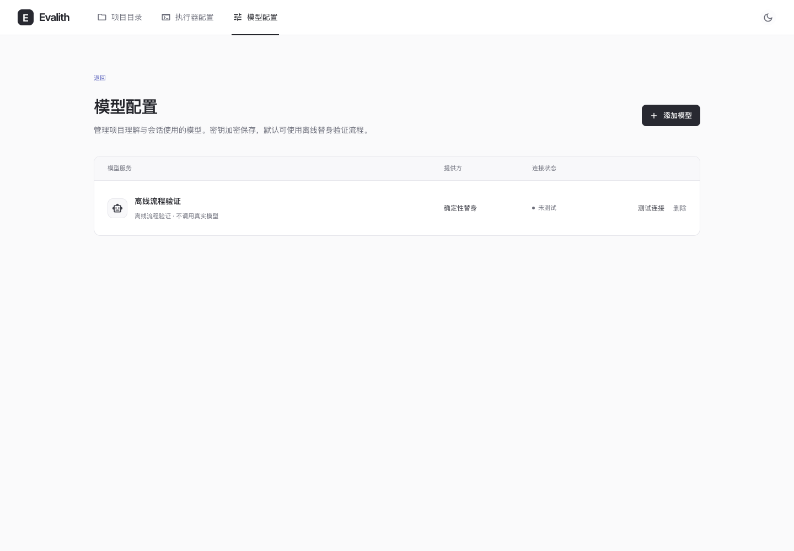
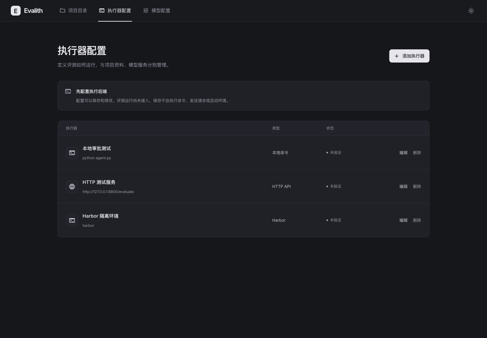
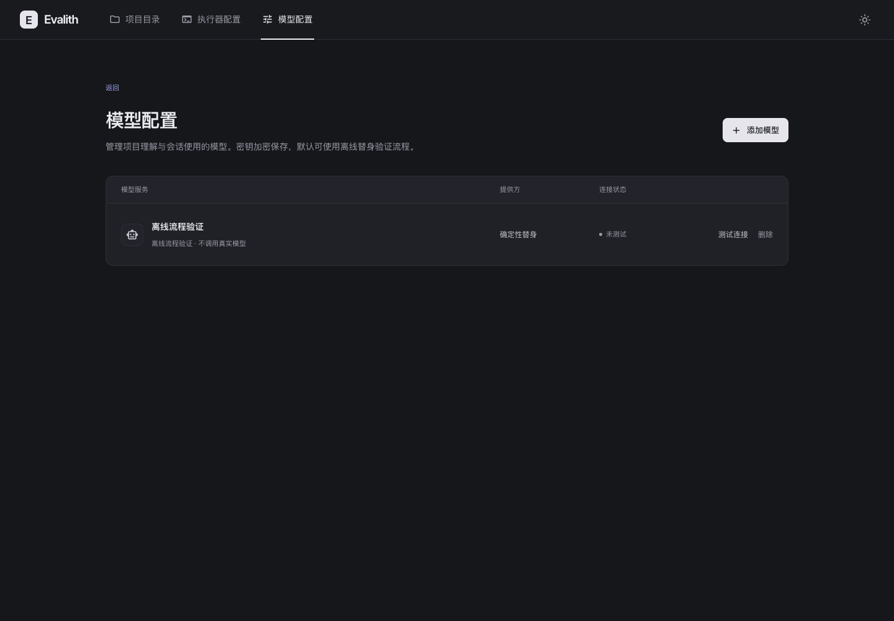

# 项目目录、独立配置与会话重做

2026-11-11。本轮按用户追加纠正替代上一版布局：先建立项目，得到项目卡片，再点击卡片进入项目会话；项目目录、评测执行器配置、模型配置分别管理。保留 Linear 风格的深浅配色，重新调整页面层级和会话阅读体验。

## 参考与设计取舍

使用 `frontend-design` skill，实际浏览了这些公开产品资料和演示：

- [Claude 项目管理](https://support.claude.com/en/articles/9519177-how-can-i-create-and-manage-projects)：项目资料与项目会话的归属关系。
- [v0 Projects](https://v0.app/docs/projects)：项目层级与按需打开的配置，查看其页面内产品演示。
- [assistant-ui 对话演示](https://www.assistant-ui.com/demos/chatgpt)：居中阅读栏、正文层级、用户气泡及输入区；自行实现，没有复制演示源码。
- [Rhesis Architect 产品截图](https://rhesis.ai/platform/verifiable)：从资料讨论逐步明确评测方向的交互。

上一版把数据应用的紧凑密度用于会话，并在项目选择前展示了项目导航。本轮移除常驻右侧上下文栏和重复页签，采用 760px 阅读栏、15px 正文、结构化理解、来源入口和独立输入区。全局三项导航始终在顶部，进入项目后才出现项目侧栏。模型回复支持 Markdown 标题、列表、代码与表格；不执行 HTML，也不自动加载模型输出的远程图片。深浅切换不动画混合主按钮的前景与背景色，避免过渡期间对比度降低。

## 三个独立入口

| 页面 | 负责内容 | 不承担的操作 |
| --- | --- | --- |
| 项目目录 `#/projects` | 建立项目、搜索、项目卡片；创建后留在目录，点击卡片进入持续会话 | 不在目录内编辑执行器或模型服务 |
| 执行器配置 `#/executors` | 保存、编辑、删除本地命令、HTTP API、Harbor 的执行器定义 | 不启动命令、发送评测请求或创建环境 |
| 模型配置 `#/models` | 模型服务、加密凭据、连接测试、删除确认 | 不配置执行程序或项目资料目录 |

项目会话仍使用项目关联的既有模型。来源与完整理解通过项目侧栏查看；切换章节和主题保留草稿，切换项目继续隔离消息与迟到响应。初始理解精简展示摘要、主要未知项与来源入口，完整依据在“项目理解”中查看，资料变化时仍显示历史理解提示并保持继续门关闭。

## 执行器配置的真实范围

用户明确执行器指评测运行后端，而不是 Claude Code / Codex 会话驱动。

新增独立的 `/api/executor-configs` GET / POST、`/{id}` PUT / DELETE；定义在独立 SQLite 表中持久保存，使用既有 Fernet 密钥加密定义。字段包括名称、后端类型、程序与参数数组、可选绝对工作目录、HTTP 地址及超时。校验类型、名称冲突、超时、URL 和不支持的凭据输入；返回明确的 `verified: false`、`execution_available: false`。

**尚未实现**：项目执行器绑定、实际执行、连接验证、Harbor 任务协议、环境创建、凭据注入及预算控制。这里只保存执行器定义，不能据此声称阶段 3 已完成。配置不会作为项目资料发送给模型。

## 验证

- 完整后端：228 项通过，包含 10 项执行器测试；只有现有 Starlette/httpx 弃用警告。
- 前端：4 个文件、39 项通过。覆盖建立后先出现卡片、卡片进入会话、三个页面独立切换、配置保存与错误保留、删除确认、模型回复排版，以及原有来源、输入法、路由、项目隔离、取消与迟到响应回归。
- 创建流程的回归检查：临时恢复“建立后自动进入会话”时，新测试按预期失败；恢复修复后全套通过。
- TypeScript / Vite 生产构建通过；新 Python 模块及测试 Ruff 检查通过；生产依赖审计 0 漏洞。
- 实际浏览器：新工作区空首页 → 配置并测试离线模型 → 建立项目 → 卡片 → 主会话 → 发送消息；检查独立模型页与执行器页、本地命令保存和刷新恢复。
- 1440×1000 为主要视觉检查尺寸。浅深会话、模型及执行器页面的 axe WCAG2A/AA 检查未发现违规；这不等于完整无障碍认证。保留基础窄屏适配，不扩大移动端工作。
- 全部截图为实际页面，使用临时合成项目和离线模型，无真实业务数据、真实密钥或付费调用。新增执行器定义未实际运行。

测试输出：[后端](evidence/evalith-project-first-backend.txt)、[前端](evidence/evalith-project-first-tests.txt)、[构建](evidence/evalith-project-first-build.txt)。

## 实际页面

| 项目入口 | 项目会话 |
| --- | --- |
|  |  |
|  |  |

| 执行器配置 | 模型配置 |
| --- | --- |
|  |  |
|  |  |

[建立项目表单](evidence/evalith-project-first-create-light.png)。之前的 `evalith-linear-*` 截图保留为历史版本。
