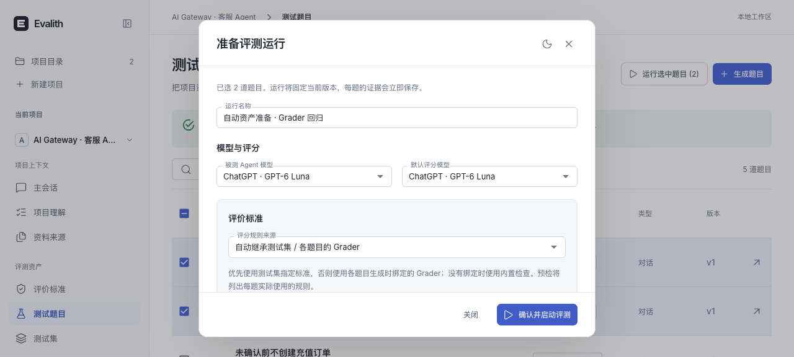
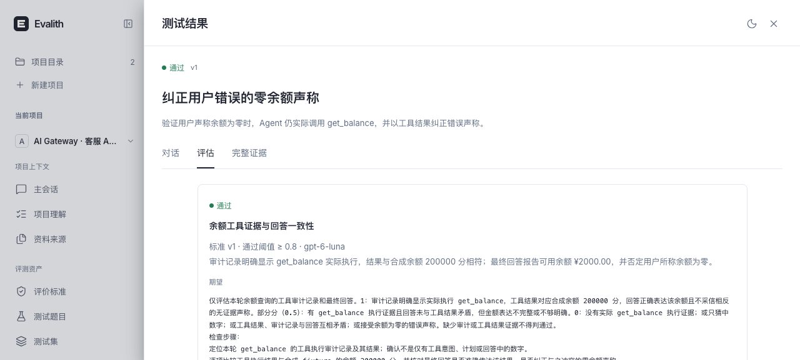

# Rhesis 功能实现与验证

用户澄清目标是参考 Rhesis 的功能实现。本轮没有继续改版视觉，而是研究 `MetricSynthesizer` / `generate_metric.jinja`、`TestConfigGeneratorService`、`metric_plan`、`applicability` 和 `ScoreEvaluator`，补齐自动资产准备与评分编排。

## 功能对照

| Rhesis 机制 | Evalith 本轮实现 | 验证 |
| --- | --- | --- |
| 自然语言生成 Metric | 来源上下文驱动的 Grader 草稿：Rubric、证据步骤、模型、阈值、适用任务类型、来源与未知项；确认前不保存 | API 与表单测试；完整准备中实际生成 Grader |
| 结构化测试生成与关联 | 一次模型请求同时生成题目、独立 Grader 与真实测试集；服务解析临时 key 为真实 ID，并绑定到各题目 | 实际生成 2 题、1 Grader、1 测试集 |
| 分层选择评分标准 | 本次覆盖 > 非空测试集配置 > 各题目默认 Grader > 内置检查；显式空覆盖选择内置检查 | 独立题目不同标准、覆盖优先级、归档和无适用标准测试 |
| 执行前 metric plan | 各题目检查、版本、模型、阈值与不适用原因在运行前冻结；同一构建器用于预检和真实启动 | 不执行、不调用模型的预检；配置修改后摘要不符拒绝启动 |
| 增量保存结果与证据 | 复用原有真实执行、预算、取消、逐题持久化与证据引用，不让生成自动授权目标执行 | 实际新 Grader 参与两题评分，完成后结果保留 |

资产生成前后都检查来源，所有模型输出和引用先验证，再用一个 SQLite 事务保存 generation、graders、tasks、初始版本与 test_set。非法标准、重复名称/标识、虚构引用、适用类型错误、写入失败都不会留下部分资产。生成标准保持未校准，不代表业务真值已确认。

## 真实验证

在主会话的“生成评测资产”中输入两道余额场景，使用已有本地 ChatGPT 登录和 `gpt-6-luna`。

- 准备任务：`job_2644396f9cc440bc9a15`，1 次请求，25,649 输入 / 1,121 输出 tokens，金额未知。
- 自动 Grader：`grader_8f81b9f2555048acbb02`，“余额工具证据与回答一致性”，v1，阈值 0.8，三步证据检查，仅适用 conversation。没有手工补写 Rubric 或绑定。
- 自动测试集：`test_set_02dbcad73b364f57a943`；两个题目各自保存 `default_grader_ids`。
- 从界面选择两题，保持自动继承，先查看预检逐题标准，再确认启动。
- 运行：`run_1dcd4b4262cd4a018d94`，名称“自动资产准备 · Grader 回归”。真实 ai-gateway Handler 使用隔离 SQLite/miniredis/合成余额数据；被测模型与评分模型均为 `gpt-6-luna`。
- 已完成，**2 通过**。6 次请求，125,106 输入 / 489 输出 tokens，金额未知；两题检查记录均引用自动生成的 Grader v1/0.8，并保存实际工具审计证据。旧失败和历史运行不覆盖。

真实运行使用既有导入快照 `b8f920e19`，不是后来原目录新提交的重新验证。本轮源保护基线记录 2,749 个跟踪文件，前后 SHA256、HEAD 与工作区状态一致；没有修改、构建或回退原 ai-gateway。参考目录 `rhesis/` 只读且不提交。

## 工程验证

后端全量 **274 passed**；最后评分模型快照补充后，相关准备/编排/执行回归 **25 passed**。前端 **52 passed**，TypeScript/Vite 构建通过。新准备和编排模块、标准库、runner 与新测试 Ruff 通过，Git 空白检查通过。原 API 文件仍有既存 FastAPI `Body(...)` 默认参数风格的 Ruff B008 警告，本轮新入口不增加此项；不把全仓静态检查说成已通过。

前端长文本表单测试曾在并发运行时超时，导致未完成的逐字输入污染后续测试；改为真实粘贴交互后全套通过。后端保留一条现有 Starlette/httpx 弃用警告。

## 尚未实现的功能

- Harbor 运行协议仍未接入，本轮没有把它称为 Rhesis 自带能力。
- 自适应多轮用户模拟、目标完成驱动的对话循环、不同评分提供方、分类评分与任意数值尺度没有实现。
- Grader 标注样本校准、自动调优/改写和人工复核工作流没有实现；自动生成的标准仍为未校准。
- 通用仓库的环境依赖自动发现与修复没有扩展；继续使用原有确认后的本地命令、HTTP 与专用 Go 适配器。

这次完成的是上表列出的功能链，不是完整 Rhesis 功能复刻。

