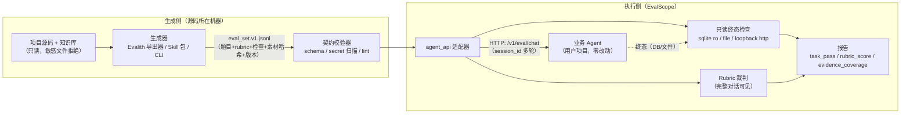

# PRD：源码生成题目集能力——实现方案

对应 issue #2166。一条链路：**读项目源码与知识库 → 生成评测题目集（题目+Rubric+检查）→
EvalScope 调用项目暴露的 Agent HTTP API 执行 → 报告**。本文档回答"怎么实现"：
组件、接口、数据结构、落点与任务拆解。定位与措辞类内容在 issue 回复草稿，不在此重复。

## 1. 总体架构

（交互版架构图见 [architecture.html](architecture.html)；下方为文本版。）

两侧行为边界：生成侧不管执行与评判；执行侧不读源码、不含生成逻辑；
两侧唯一耦合是契约文档。

## 1.5 题目生成怎么接入：生成器契约与流水线

生成器是一个**可替换的组件**，接入方式 = 实现下面这个输入输出契约；
EvalScope 侧不感知生成器的存在，只消费产物。

**输入**（生成器调用方提供）：

| 参数 | 说明 |
|---|---|
| `source_root` | 项目根目录；生成器只读，敏感文件按清单拒绝 |
| `knowledge` | 业务资料（文档/知识库路径或片段），可为空 |
| `direction` | 评测方向与数量（自然语言，≤4000 字） |
| `model` | OpenAI 兼容端点 + 模型名 + 密钥（用户自配，可指向内网/本地模型） |
| `options` | 扫描范围 include/exclude、生成数量 1–12 |

**输出**：`eval_set.v1.jsonl`（§2 契约）+ 生成报告（每题的 source_refs、
素材哈希、发送留痕、模型用量）。

**流水线四步**（三种形态共用同一逻辑，差异只在载体）：

1. **扫描**：只读遍历 `source_root`，按 include/exclude 圈定范围，
   敏感文件（.env/密钥/.ssh/凭据）拒绝读取；记录每文件 sha256。
   超出上下文预算的文件截断并标记 `sent: false`。
2. **理解**：把扫描产物（文件清单+关键文件内容+知识库）发给 `model`，
   产出结构化理解：已知事实 / 推断 / 未知项。未知项必须显式返回，
   不默认当作已确认——调用方（人或流程）确认后才进入出题。
3. **出题**：第二次模型调用。输入 = 理解结果 + `direction` + 输出 JSON
   schema（题目字段见 §2）；输出 = N 道题，每题必须带 source_refs
   （回链到具体文件行）与 uncertainties。生成失败不落盘（不留半套资产）。
4. **校验与定版**：产物过契约校验器（schema + secret 扫描 + 会话内不变量
   lint），通过后写入版本号；人工可编辑，编辑产生新版本。

**三种形态如何实现同一契约**：

| 形态 | 载体 | 实现要点 |
|---|---|---|
| Evalith 导出器（已实现） | 产品内 `integrations/evalscope/mapping.py` | 1–3 步走产品管线（理解会话、生成任务、版本管理），第 4 步后由 `exporter.py` 把内部任务记录映射为契约字段导出 |
| Skill 包（M2） | `SKILL.md` + 校验脚本，挂在用户已有编码 Agent 上 | 流水线写成对 Agent 的指令：步骤 1 用 Agent 自带只读工具圈范围读文件（提示词内嵌敏感清单与"不发送未过审文件"约束），步骤 2/3 是两次结构化对话（理解→按 schema 出题），步骤 4 强制调用随包校验脚本，不过校验不算完成 |
| 独立 CLI（M3） | 复用导出器的 mapping，去产品依赖 | 纯代码实现四步，参数即上表输入；可 OS 级只读挂载运行 |

对接入方（EvalScope）而言，三种形态没有区别：**拿到一份通过校验的
eval_set.v1.jsonl**。校验器与导入页已实现（§4 组件 #1/#5）。

## 2. 数据契约：eval_set.v1.jsonl

每行一道题。字段（前 12 个已实现并有真实样例，后 4 个为 M2 安全/环境增强）：

| 字段 | 类型 | 说明 | 状态 |
|---|---|---|---|
| `id` / `version` | str / int | 题目标识与版本，编辑后自增 | 已实现 |
| `question` / `messages` | str / list | 单轮问题 / 多轮用户输入（按序发送） | 已实现 |
| `rubric[]` | list | `{id, criterion, weight, must_pass, evidence_requirement: answer\|process\|outcome}` | 已实现 |
| `checks[]` | list | 终态检查（§4 检查器） | 已实现 |
| `exec` | obj | `{type: agent_api, protocol: rest_steps, agent_url_env, reset_url, trace.mode, session.id_from}` | 已实现 |
| `pass_threshold` | float | rubric 加权通过阈值（默认 0.6） | 已实现 |
| `source_refs` / `materials[]` | list | 行号级引用 / `{path, sha256}` 素材哈希 | 已实现 |
| `reference_answer` / `expected_facts` / `forbidden_facts` | — | 裁判上下文（可选） | 已实现 |
| `metadata` | obj | uncertainties、unsupported_checks、生成溯源（generation_id/model/usage） | 已实现 |
| `data_classification` | str | 题目集分级（public/internal/confidential），分享策略派生 | M2 |
| `redaction` | obj | 脱敏声明进元数据，校验器 fail-closed | M2 |
| `judge_input` | obj | 裁判可见字段白名单；reference_answer 支持哈希比对 | M2 |
| `env_assumptions` | obj | 生成侧环境假设（金额/播种数据/话术），供校验器与 dry-run 比对 | M2 |

## 3. 业务 Agent HTTP 接口约定

用户项目（或其薄 wrapper）暴露三个端点，全部 loopback 或内网：

| 端点 | 请求 | 响应 | 作用 |
|---|---|---|---|
| `GET /health` | — | `{status, trace_mode}` | 探活与 trace 能力声明（l0/l2） |
| `POST /v1/eval/chat` | `{session_id, message}` | `{reply, steps[], pending_confirm, usage}` | 一轮对话；steps 供 L2 trace（无则降级 L0） |
| `POST /v1/eval/reset`（可选） | — | `{status}` | 批次前重建测试环境 |

多轮题目按 `session_id` 连续调用；无 reset 的项目用独立 session 隔离。
已验证实现：ai-gateway 真实 Handler + 薄 wrapper（`examples/aigateway/http-adapter/`）。

## 4. 组件清单与落点

| # | 组件 | 代码位置 | 状态 |
|---|---|---|---|
| 1 | 契约模型与加载校验 | EvalScope `evalscope/project_eval/schema.py`（pydantic） | 已实现（导入时校验） |
| 2 | agent_api 适配器 | EvalScope `benchmarks/project_eval/{project_eval_adapter,agent_clients}.py` | 已实现（含多轮对话采集） |
| 3 | 只读终态检查执行器 | EvalScope `evalscope/project_eval/checks.py` | 已实现 |
| 4 | 报告与降级语义 | EvalScope 报告字段 task_pass/rubric_score/evidence_coverage、not_evaluable | 已实现 |
| 5 | Eval Sets 导入页 | EvalScope service blueprint + web 页 | 已实现 |
| 6 | Evalith 导出器 | 本仓库 `evalith/src/evalith/integrations/evalscope/` | 已实现（含单测） |
| 7 | 生成全流程（扫描→理解→出题→编辑→版本） | 本仓库 Evalith 产品 | 已实现（本次真实模型验证） |
| 8 | 独立校验器 CLI | 从 #1 抽出：`evalscope-project-eval validate <file>` | M2 |
| 9 | 环境契约比对 + 单题 dry-run | EvalScope 校验器 + `--dry-run`（跑单题、只出证据不出分） | M2 |
| 10 | Skill 包 | `skills/evalset-generator/`：SKILL.md（提示词+只读约束+输出格式）+ 校验脚本 | M2 |
| 11 | 独立生成 CLI | 复用 #6 的 mapping，去掉产品依赖 | M3 |
| 12 | trace 分层采集 | OTel 接收端 → 审计表/日志适配 → 网关观测 | M4 |

## 5. 安全实现（映射到代码）

| 要求 | 实现点 | 状态 |
|---|---|---|
| 生成只读 | Evalith 扫描器只读 + 敏感文件拒绝清单（.env/密钥/.ssh 等） | 已实现 |
| 模型端点用户自配 | Evalith 模型配置（密钥加密存储）；CLI 显式传参 | 已实现/设计 |
| 发送留痕 | 快照 sources[].sent + redactions 计数 | 已实现 |
| 产物最小化 | materials 只带 sha256，不带源码内容 | 已实现 |
| 检查只读 | checks.py：SQLite `mode=ro`、路径逃逸/敏感路径拒绝、HTTP 限 loopback、reset_url 强制 loopback | 已实现 |
| 裁判边界 | judge prompt 组装点（adapter #2）：按 `judge_input` 白名单组装，reference_answer 哈希比对 | M2 |
| 产物分级与脱敏 | 契约字段 + 校验器 fail-closed + 全文 secret 扫描 | M2 |
| 会话内不变量 lint | 校验器规则：禁止断言引用跨会话共享状态 | M2 |

已知限制（开放跟踪）：语义级泄露检测（源码经提示注入诱导写入题目文本）；
被测 Agent 内部模型与裁判端点在生成侧边界外，靠契约声明与运行时校验约束。

## 6. 任务拆解

**M2（目标：生成→可执行当天闭环）**
1. 校验器 CLI 抽取（#8）：schema 校验 + secret 扫描 + 会话内不变量 lint，
   退出码可供 CI 使用；~200 行，从现有 schema.py/checks.py 复用规则。
2. 契约安全字段（#2 表 M2 四字段）+ 校验器强制。
3. `env_assumptions` 比对与 `--dry-run`（#9）：单题执行，输出对话/检查证据
   供人工核对，不产出分数；解决本次 demo 暴露的 fixture 对齐问题。
4. Skill 包（#10）：SKILL.md（只读约束、敏感清单、输出=契约字段、
   生成后必须过校验器）+ 校验脚本；以本 demo 的 ai-gateway 为内置示例。

**M3**：独立生成 CLI（#11）；生态文档页。
**M4**：OTel 接收端与 session 关联头约定（`X-Eval-Session-Id`）。

## 7. 验收标准

- M2：任一生成形态产出的 eval_set 能被校验器通过、被 EvalScope 一次导入并执行；
  dry-run 能在出题后 10 分钟内暴露环境假设不一致；注入 secret 的题目集被拒。
- M4：无 trace 的项目（L0）自动降级出分，process 标准 not_evaluable，
  OTel 项目（L2）process 标准可评。
