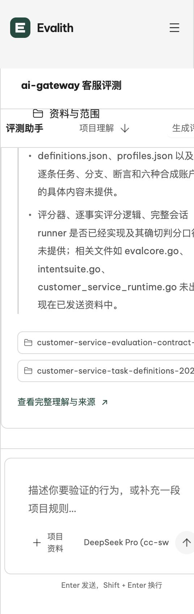
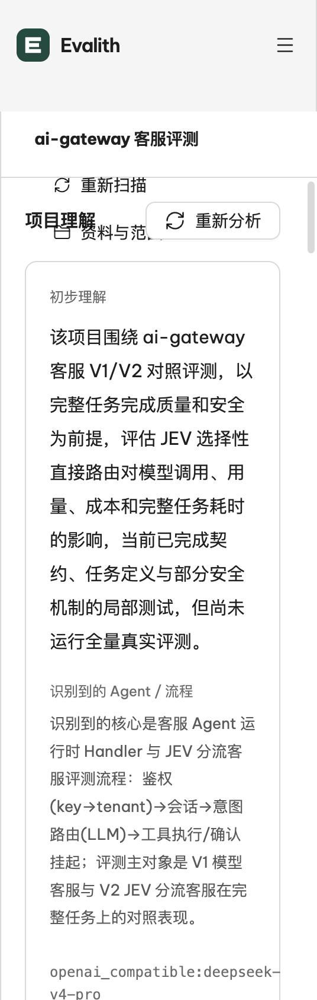
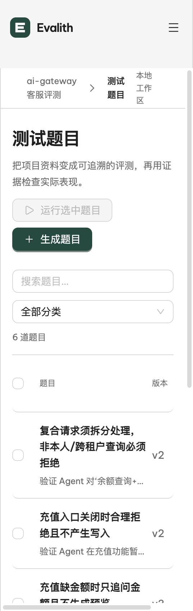
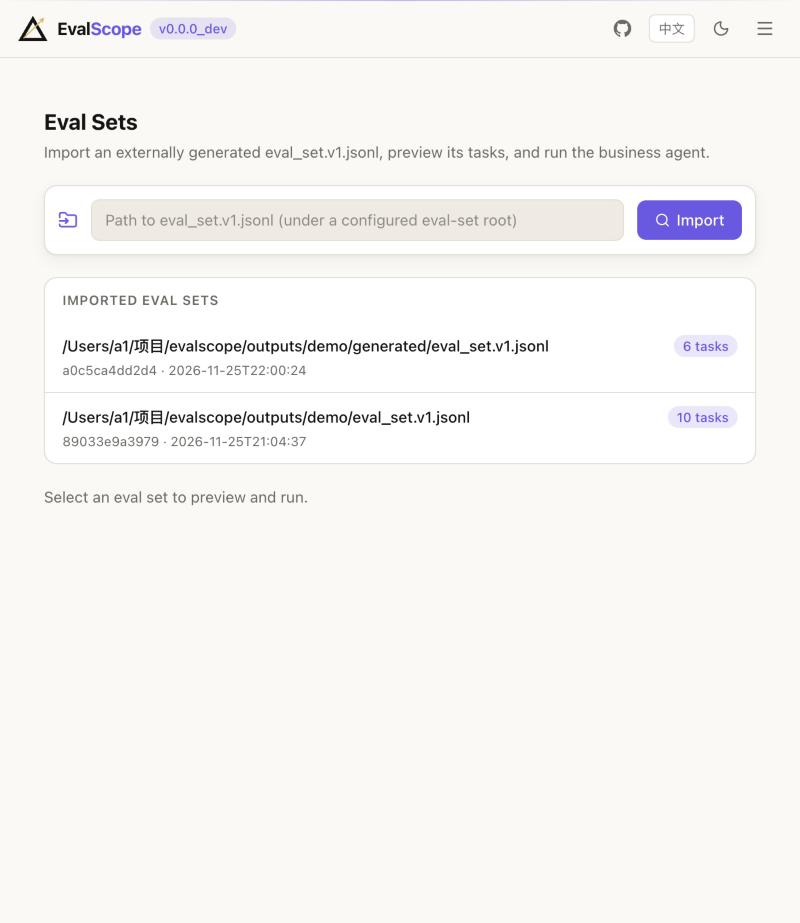
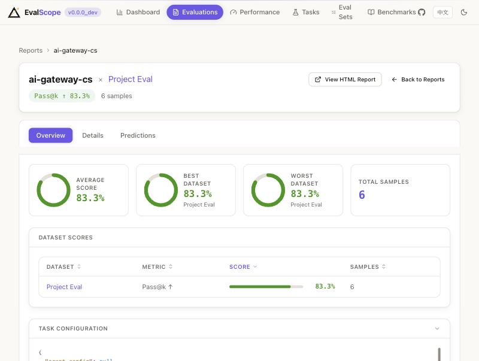
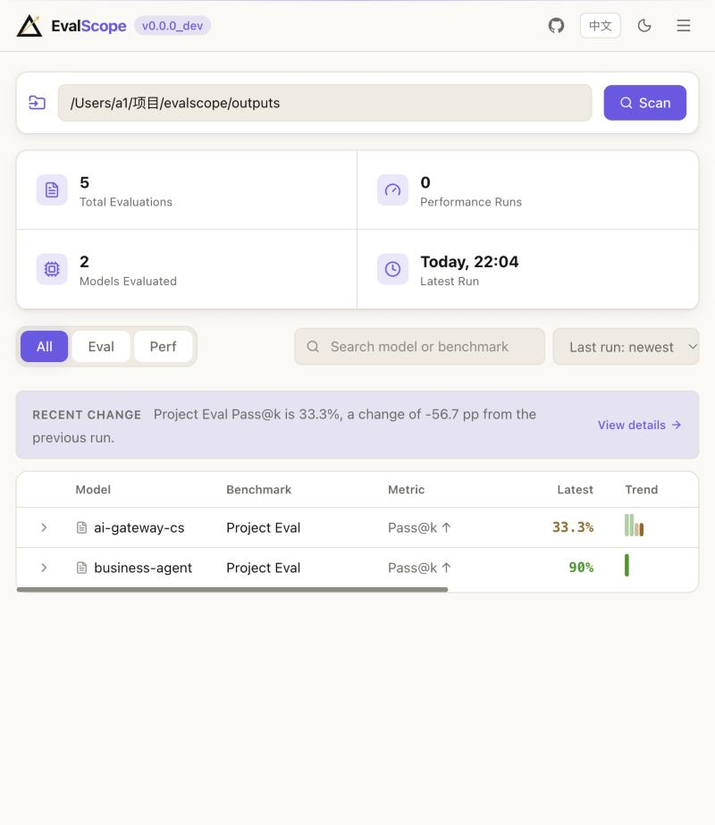

# 项目评测 Demo 流程

Evalith 读源码生成题目集与 Rubric，EvalScope 通过项目暴露的 Agent API 执行并出报告。
业务代码零改动。截图为实际运行界面（2026-11-25）。

```text
Evalith（生成侧）                      EvalScope（执行侧）
1. 导入项目源码（只读）                4. 导入题目集 eval_set.v1.jsonl
2. 模型理解源码，明确未知项            5. 调用项目暴露的 Agent HTTP API 执行
3. 生成题目 + Rubric + 检查 → 导出     6. 终态检查 + Rubric 裁判 → 报告
```

## 1. Evalith 导入项目，模型阅读源码

只读扫描 ai-gateway 仓库（116 个文件），敏感文件自动拒绝；模型产出项目理解，
未知业务点显式列出，不默认当成已确认。





## 2. 生成题目集与 Rubric

给定评测方向与数量，一轮模型调用生成对话题目：每题含多轮输入、Rubric、
检查项、源码/文档引用与版本号。题目可人工编辑校准，版本自动留痕。



## 3. 导出题目集

导出为 `eval_set.v1.jsonl`（题目、rubric、检查、执行配置、素材哈希、版本），
EvalScope 只消费这一份契约文档。

## 4. EvalScope 导入并执行

Dashboard 的 Eval Sets 页导入题目集，预览每题的 rubric、检查与来源引用；
运行时填项目暴露的 Agent URL 与裁判模型。



## 5. 结果报告

执行完成后出报告：逐题的完整对话、工具轨迹、终态检查（SQLite 查业务库）、
Rubric 判定与证据引用。




