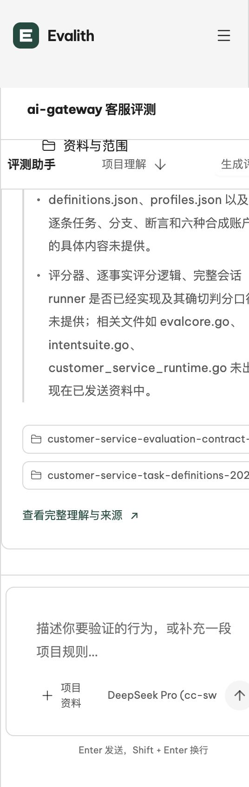
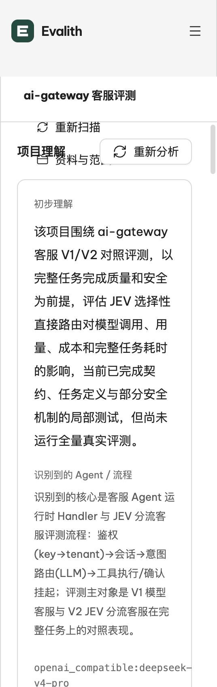
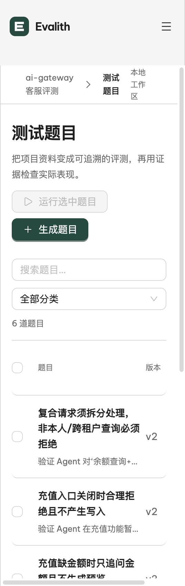
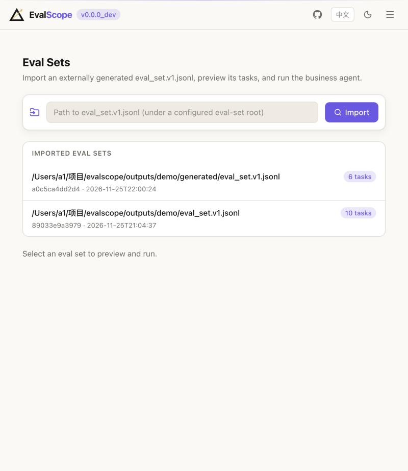
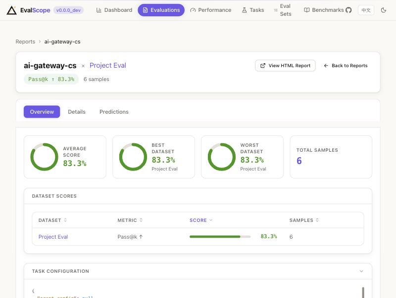
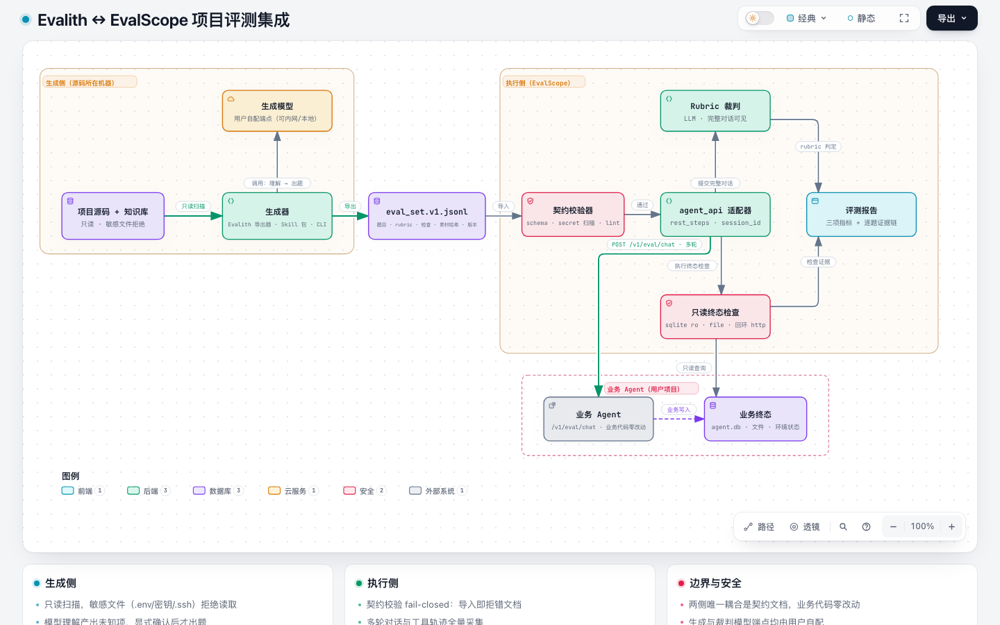

按您建议的分工跑了最小端到端验证（真实模型：生成、被测 Agent、裁判全程真实调用），demo 流程和方案如下，几个技术选择想跟您对齐。

## Demo 流程

```text
Evalith（生成侧）                      EvalScope（执行侧）
1. 导入项目源码（只读）                4. 导入题目集 eval_set.v1.jsonl
2. 模型理解源码，明确未知项            5. 调用项目暴露的 Agent HTTP API 执行
3. 生成题目 + Rubric + 检查 → 导出     6. 终态检查 + Rubric 裁判 → 报告
```

被测 Agent 是真实业务 Handler，业务代码零改动，只暴露一个 `POST /v1/eval/chat`。











## 方案（PRD 摘要）



整体架构与实现方案整理成了 [PRD](https://github.com/frostloom/Evalith/blob/issue-2166-demo-assets/examples/aigateway/evalscope/PRD-evalset-generation.md)，要点：

- **契约进 EvalScope，生成留外部**：`eval_set.v1.jsonl`（题目 / rubric / 检查 / 执行配置 / 素材哈希 / 版本）作为开放契约 + 契约校验器 + agent_api 适配器 + 只读终态检查执行器；任何产出合格文档的生成工具皆可接入（提示词包 / CLI / 带编辑与版本管理的外部产品）。
- **执行走用户项目暴露的 HTTP API**，业务代码零改动。
- **MVP 评判 = 最终回答 + Rubric + 业务终态检查**（验证中出现过会话层回答完全正常、只有查审计库才能发现问题的案例）；多轮任务把完整对话喂给裁判。
- **trace 后续分层引入**：OTel 环境变量最短路径 → 消费项目已有审计表/日志 → 网关观测点。
- **数据安全**：生成只读 + 敏感文件拒绝、模型端点用户自配（可内网/本地）、产物只带哈希引用；契约级安全字段（数据分级、脱敏声明、裁判输入白名单）已写入 PRD。

## 想跟您商量的技术选择

1. MVP 先以"最终结果 + Rubric + 终态检查"评判、trace 后续分层引入，这个节奏您是否认可？
2. 题目生成以独立外部工具接入（产出契约文档即可），EvalScope 只收契约与执行——与您原帖分工一致，是否有需要上收的例外？
3. 契约的版本治理（schema 演进与迁移）以及与现有任务/数据格式的兼容口径，希望听听您的想法。

演示文档、EvalScope 侧改动（契约 + 校验 + adapter + 终态检查 + 测试）和评测集样例都在，需要的话可以继续补充。
